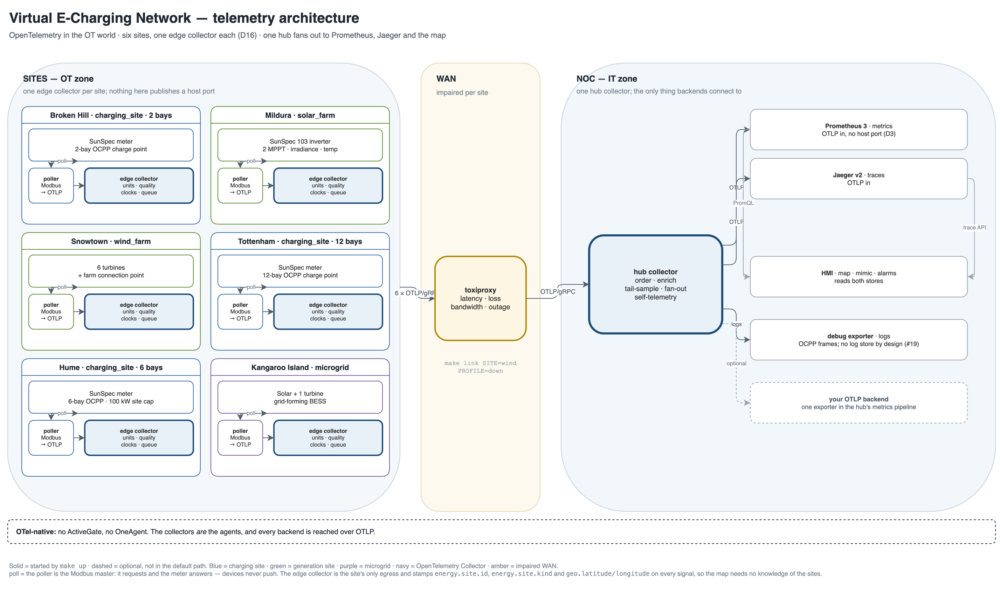

# Virtual E-Charging Network

A fully virtual electric-vehicle charging network — utility-scale generation, distribution feeders,
charge points with cars on them — instrumented end to end with **OpenTelemetry only**. There is no
vendor agent anywhere in it: the collectors *are* the agents.

The thesis is that **OpenTelemetry is useful far beyond application monitoring**. Device telemetry has
quality codes, unaligned clocks and links that disappear for hours. The Collector is a natural,
testable boundary between operational technology (OT) and IT. This repo runs those cases rather than
asserting them.



Source of truth: [`docs/architecture.drawio`](docs/architecture.drawio); solid is running today, dashed planned.

## The idea

Devices speak Modbus or OCPP, not OTLP. A small poller per site reads the device on its own terms and
forwards OTLP to an **edge collector**, which adds meaning (names, units, quality, timestamps), buffers
to disk and is the site's only egress. Edge collectors cross an impaired WAN to one **hub**, which fans
out to Prometheus, Jaeger and a map.

`[meter | inverter | turbines | battery | charge points] -> poller -> edge -> WAN -> hub -> stores`

Two collector layers, and only two (D16): edge per site, one hub. More than that leaks every site's
quirks into one config and destroys store-and-forward.

## If you came from observability, look at these five things

| Pattern | How it appears here | Why your normal stack cannot express it |
|---|---|---|
| **A business event as a trace** | One charging session is one trace: `ocpp.session` is the root, `authorize` / `start` / `meter_values` / `stop` are children | APM models a request that ends in milliseconds. A ten-minute transaction whose stop reason is a physical measurement has no request to hang off. |
| **Quality as a data point attribute** | `otel.data_point.quality` = `good` / `stale` / `bad` / `comms-lost`, authored by the edge collector (D21) | Neither Modbus nor OTLP has a status field for a value that is present but not trustworthy; Prometheus cannot say "stale, but not yet gone". |
| **Two timestamps per sample** | `energy.device.timestamp` (the device's clock) and `energy.receive.timestamp` (when the collector saw it) | OT sites run with no usable NTP, so the two disagree by seconds to minutes. OTLP metrics carry one timestamp; the receive time rides as a data point attribute (D12, D23). |
| **A WAN outage that loses nothing** | The edge queue is on disk. It fills during an outage and drains on restore — measured, not projected | An SDK retry queue drops what it cannot hold in memory. Multi-hour retention is a collector feature, not an app one. |
| **The Collector as the OT/IT boundary** | Nothing in the OT zone publishes a host port; one egress process per site; control is `docker compose exec` | Agent-per-host topologies assume the agent can reach out and be reached. Here the gap is the point, and the thing inside it has to speak the device protocol. |

Each has a command below and a decision in [`plan.md`](plan.md). The sharpest is the time one:
`./tools/clock-inversion.sh` pushes a device clock four minutes out, and a session stop then arrives
**before** the sag that caused it — unless you order by receive time (D42, [`docs/ot-primer.md`](docs/ot-primer.md#51-the-clock-problem-with-a-worked-example)).

## See it in 60 seconds

```bash
make up                          # the whole stack; ends at http://127.0.0.1:8091
make queues                      # five edges, all zero: the links are clean
make spine                       # sag -> derate -> failed session, in one command
make session-status SITE=metro   # twelve bays: supply voltage, state, kW, offered A, tx
```

`make spine` drops supply voltage to 0.88 pu (per-unit — 0.88 × 230 V), the charger **derates** (reduces its
offered current) to 10.3 kW, then 0.78 pu ends the transaction for `PowerLoss`. Nothing is scripted on the
trace side: the charge point reads the meter over Modbus and reacts. Night where you are?
`make up SOLAR_CLOCK_HOUR=12` pins the solar farm to daytime.

## What is running

Five sites, one image, one poller, one edge config; they differ by environment and scale (D10, D37).
Every sort of site is here: a load on a weak feeder, two generators, a twelve-bay depot, and an island
that makes its own frequency.

| Site | Regime | `energy.site.kind` | Devices | Link | Bays |
|---|---|---|---|---|---|
| `rural` | load, weak feeder | `charging_site` | SunSpec meter (the solar/meter register-map standard) + a 2-bay charge point | 4G, impaired | 2 |
| `solar-mildura` | generation | `solar_farm` | SunSpec 103 inverter, 2 MPPT (maximum-power-point) trackers, irradiance/temperature | impaired | — |
| `wind-snowtown` | generation | `wind_farm` | 6 turbines + a farm connection point | impaired | — |
| `metro-tottenham` | load, depot | `charging_site` | SunSpec meter + a 12-bay charge point | 12 ms fibre | 12 |
| `microgrid-kangaroo-island` | island | `microgrid` | Solar + one turbine + a grid-forming battery; no feeder, so frequency is set on site | impaired | — |

The kind splits *regime*, not size: the rural site and the depot are both `charging_site`. Plain words per
site, and which metric families live where: [`docs/telemetry.md` §1](docs/telemetry.md#1-the-sites-spelled-out).
Five impaired links (`wet`/`degraded`/`satellite`/`down`); the visual layer is Prometheus + Jaeger + our own
map and mimic, fed only from the pipeline. Measured: 24 containers, 1 048 MiB ([`docs/sizing.md`](docs/sizing.md)).

## What the stack emits, before you run it

| Signal | What you get | Where it lands | Detail |
|---|---|---|---|
| **Metrics** | 310 `energy_*` series today (moves with live sessions): meter, EVSE/session, inverter/PV, turbine/wind-farm, microgrid/BESS. Every point carries `otel.data_point.quality` and splits by `energy_site_name`, `energy_site_id`, `energy_site_kind`, plus `energy_phase`, `energy_direction`, `energy_evse_id`, `energy_mppt`, `energy_turbine`, `energy_source_name` | Prometheus 3 over OTLP from the hub, no host port: `make prom Q='...'` | [§3](docs/telemetry.md#3-metrics), [charts to build first](docs/telemetry.md#36-charts-to-build-in-the-first-ten-minutes) |
| **Traces** | One trace per session: `ocpp.session` → `authorize` / `start_transaction` / `meter_values` / `energy.voltage_sag` / `stop_transaction`; `ocpp.boot` is a separate trace | Jaeger v2 over OTLP: <http://127.0.0.1:16687> | [§4](docs/telemetry.md#4-traces) |
| **Logs** | Every OCPP frame with `ocpp.action`, `ocpp.message.direction`, `ocpp.charge_point.id`, `ocpp.transaction.id`, `ocpp.frame`; the charge point's copies carry the session's `trace_id` | The hub's `debug` exporter — `make logs`, `make ocpp-logs`. **No log store by design** (#19) | [§5](docs/telemetry.md#5-logs) |
| **Collectors' own telemetry** | `otelcol_*` queue depth/capacity, refused and failed exports — the store-and-forward signal | Edge `:8888`, hub `:8889`, `make queues` | [§6](docs/telemetry.md#6-the-collectors-own-telemetry) |

**Configs:** [`collector/edge/site.yaml`](collector/edge/site.yaml) holds every device semantic and is
identical for all five sites; [`collector/hub/hub.yaml`](collector/hub/hub.yaml) holds the fan-out.
**You only ever edit the hub** — point its two `VISUAL_*_ENDPOINT` variables at your own OTLP endpoint,
or add an exporter to its `metrics` pipeline for the untouched backend-of-record copy
([§7](docs/telemetry.md#7-where-the-configs-are-and-how-to-point-this-at-your-backend); to break it on
purpose, `make link SITE=wind PROFILE=down|satellite|degraded` and [§8](docs/telemetry.md#8-toxiproxy-the-problem-patterns-and-what-they-do-to-the-telemetry)).

## One session is one trace

The charge point is the only process here that is both an OCPP client and a Modbus client, and that is
the point: it reads the meter's phase voltages, so a sag is something it **measures**. Offered current
falls linearly between 0.94 pu and 0.80 pu; below 0.80 pu for three seconds the transaction ends for
`PowerLoss`. One session is one trace, owned by the charge point:

```
ocpp.session                 root — ocpp.stop.reason=PowerLoss, energy.session.energy_kwh
├── ocpp.authorize
├── ocpp.start_transaction   ocpp.transaction.id allocated here
├── ocpp.meter_values        every 10 s, carrying energy, power, offered current
├── energy.voltage_sag       starts below 0.94 pu; ends on recovery or when the session fails
└── ocpp.stop_transaction    reason=Local or PowerLoss
```

`BootNotification` and the `StatusNotification`s are a *separate* short trace: a boot is a property of
the connection, not of a transaction. OCPP frames are logs — the charge point's copies carry the session's
`trace_id`, the CSMS cannot, so its copies are joined by `ocpp.transaction.id`; OCPP 1.6 has nowhere to
put a `traceparent` ([`docs/standards.md`](docs/standards.md) §6). The depot keeps this true under
concurrency: twelve live sessions, twelve traces.

## Is it technically honest?

**Real:** Modbus TCP function 03 against SunSpec-shaped register maps (models 203, 103, 160, 302/303, 123,
vendor extensions — subsets, labelled as subsets), and OCPP 1.6J over a real WebSocket with the `ocpp1.6`
subprotocol. **Modelled:** the physics — irradiance, cell temperature, a cube-law wind curve, a swing
equation with droop control on the island, the charger's linear derate. **Not done:** IEC 61850, DNP3,
OPC UA, real protection, real settlement, a power-flow model, OCPP conformance. Per-device fidelity, with
the source of every number: [`docs/standards.md`](docs/standards.md).

**Measured:** 1 048 MiB for 24 containers against a 3 GB budget; six series per bay — 87 `energy_evse.*` across
the two charging sites, 74 of them the depot's twelve; 27 on the island, whose four source metrics carry
solar and wind as a dimension, not as two names (D40, [`docs/sizing.md`](docs/sizing.md)).

**One measured limitation that simplification must not lose:** the metric-exemplar leg from the sag's
data point to its session trace is wired end to end and Prometheus' OTLP receiver drops the exemplar —
`/api/v1/query_exemplars` returns `[]` on 3.1.0 and 3.8.1, collectors bypassed. `make exemplar` shows the
empty answer; the join that works today is `ocpp.transaction.id` (D33).

## More to run

| Command | What it does |
|---|---|
| `make logs` · `make stats` · `make ps` | follow the hub · CPU/RAM of the stack · what is running |
| `make prom Q='count by (__name__) ({__name__=~"energy.*"})'` | PromQL through the `ops` box; Prometheus has no host port |
| `make fault SITE=rural FAULT=voltage-sag ARGS="--depth 0.6 --duration 30"` | inject the one fault this repo models; `FAULT=clear` clears it |
| `make curtail SITE=solar PCT=60` · `make link SITE=wind PROFILE=down` | operator curtailment, distinct from clipping · a hard outage, then watch `make queues` |
| `make step KW=300` · `make microgrid-status` · `make clock-skew SITE=rural SECONDS=240` | a load step on the island, the grid former's response, and a device clock pushed out at runtime (D42) |
| `make session SITE=metro EVSE=EVSE07` · `make exemplar` | one bay's transaction · ask for exemplars, get `[]` |
| `make slo` · `make demo` | the four SLOs with targets · the whole story, ending in a verdict |
| `make clean` | stop and delete everything, including buffered telemetry |

The rest is in the [`Makefile`](Makefile); the measurement harnesses (`outage-measure.sh`,
`microgrid-step-measure.sh`, `clock-inversion.sh`, `shot.js`) are in `tools/`.

## Docs map

| | |
|---|---|
| [`docs/telemetry.md`](docs/telemetry.md) | **start here if you just cloned it**: five sites, every metric and its split keys, traces, logs, pointing it at your backend |
| [`plan.md`](plan.md) · [issues](https://github.com/agardnerIT/virtual-e-charging-network/issues) | decisions D1–D43 (source of truth) · the work, in milestones |
| [`docs/sites/`](docs/sites) | [`rural`](docs/sites/rural.md) scaling, deadband, the sag · [`generation`](docs/sites/generation.md) clipping, cube law · [`metro`](docs/sites/metro.md) twelve bays · [`microgrid`](docs/sites/microgrid.md) why frequency moves |
| [`docs/ot-primer.md`](docs/ot-primer.md) · [`docs/standards.md`](docs/standards.md) | the electrical side for IT people, including the clock problem · which spec each device claims, and how faithfully |
| [`docs/sizing.md`](docs/sizing.md) · [`docs/findings.md`](docs/findings.md) · [`docs/hmi.md`](docs/hmi.md) | measured RAM/disk/cardinality · the things that cost an hour · the map and the mimic |
| [`CONTRIBUTING.md`](CONTRIBUTING.md) | conventions, the file tree, the checklist before "done" |

## Status and next

M0–M3 are complete and verified: five sites, a picture at <http://127.0.0.1:8091>, five clean edges, `make
spine` ending in `PowerLoss`, twelve bays at the depot. Next: **M4**, in the [milestones](https://github.com/agardnerIT/virtual-e-charging-network/milestones).
